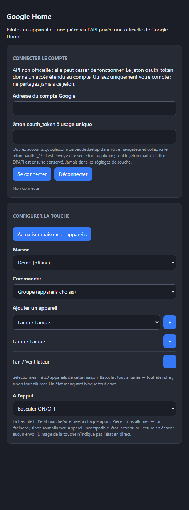
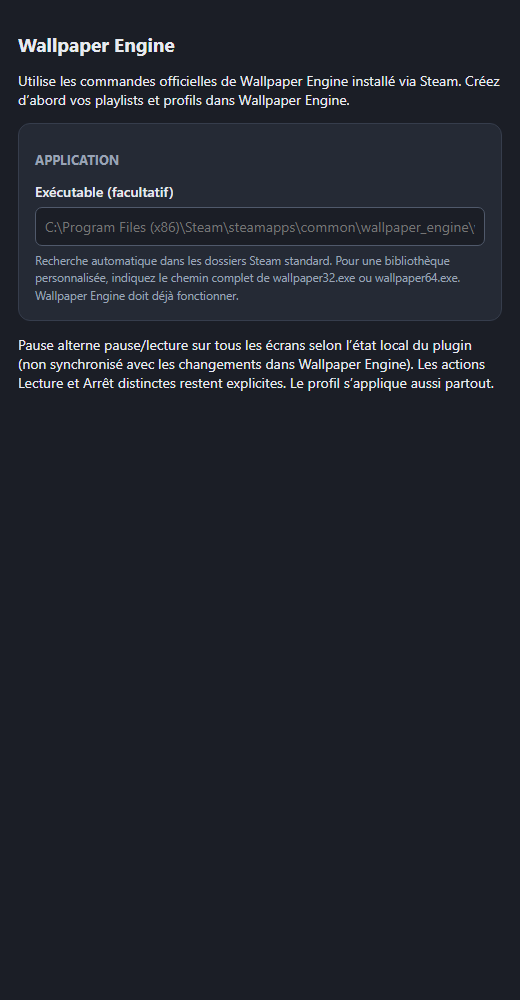

# Plugins communautaires NovyDeck

[English](README.md) | [Français](README.fr.md)

Un catalogue de plugins libres pour [NovyDeck](https://github.com/HatiFlash/NovyDeck). Consultez [CONTRIBUTING.fr.md](CONTRIBUTING.fr.md) pour proposer un plugin.

## Nouveautés 1.0.4

- **Google Home :** bascule ON/OFF selon l'état réel ; choisissez **Groupe (appareils choisis)** puis **+** / **−** pour commander plusieurs appareils depuis une touche. Les réglages existants et la connexion chiffrée sont conservés.
- **Wallpaper Engine :** la touche Pause existante alterne Pause / Lecture sur tous les écrans. Son état est local au plugin, non synchronisé avec les changements de lecture externes.
- Dans NovyDeck, actualisez le magasin et mettez à jour ces deux plugins. Voir le [guide de configuration et les limites](first-party/README.md).

## Plugins NovyDeck officiels

Sources et empaquetage : [first-party/](first-party/). Les neuf plugins natifs sont Horloge, Compteur, Moniteur système, Lecture en cours, Économiseur OLED, Home Assistant, Commande Google Assistant, Google Home et Wallpaper Engine. Home Assistant nécessite votre serveur et votre jeton. Commande Google Assistant envoie des phrases écrites via votre projet Google Cloud et OAuth bureau ; Google Home pilote directement appareils et pièces avec une API privée non officielle et un jeton de compte à usage unique (sans projet Cloud). Cette API peut changer sans préavis ; le jeton donne un accès étendu au compte. Wallpaper Engine nécessite une copie Steam installée et en cours d'exécution ; son exécutable propriétaire et ses fonds ne sont pas redistribués. Ces intégrations n'ont pas été vérifiées avec de vrais comptes/services ni une installation locale de Wallpaper Engine.

## Plugins communautaires

Le catalogue référence les archives officielles et leurs empreintes vérifiées. Consultez le [guide 1.0.3 et les aperçus bilingues des réglages](first-party/README.md#new-in-103--nouveautés-103) pour Google Home, Google Assistant et Wallpaper Engine. Google Home est expérimental ; aucun compte Google ni installation réelle de Wallpaper Engine n'a été qualifié.

Chaque fiche inclut page et release officielles HTTPS, SHA-256, licence libre, version exacte, decks testés (liste vide si non testés) et `min_novydeck` obligatoire. Champs facultatifs : `description_fr`, `uuid`, `category` (`system`, `audio`, `streaming`, `productivity`, `smart-home`, `communication`, `gaming`, `utilities`), `summary`/`summary_fr` (140 caractères maximum), `icon` HTTPS PNG carré (256 Kio maximum), six `screenshots` HTTPS PNG/JPEG maximum (2 Mio et 4096 pixels par côté), 100 `actions` maximum (`name`, `name_fr` facultatif, 120 octets UTF-8), huit `tags` maximum (40 caractères) et `requires` (une chaîne de 200 caractères maximum). Voir l'[exemple](scripts/example-entry.json).

## Badges de sécurité

Le magasin de NovyDeck affiche jusqu'à trois badges par plugin :

- **Officiel** : publié par NovyDeck (`com.novydeck.*`) depuis les releases de ce dépôt.
- **Analysé** : l'archive exacte du catalogue (même SHA-256 et même version) a passé le contrôle automatique. Un workflow GitHub Actions télécharge chaque archive, vérifie son SHA-256, l'analyse avec Microsoft Defender et recherche les contenus à risque (exécutables et leurs signatures, scripts obfusqués, téléchargement puis exécution, clés de démarrage, cohérence du manifest, licence et source officielle). Il tourne à chaque modification du catalogue, chaque semaine et à la demande, sans intervention manuelle ; les résultats sont publiés dans [`security/scan-results.json`](security/scan-results.json).
- **Testé par NovyDeck** : cette version précise a été essayée à la main dans NovyDeck (champ `tested_by_novydeck`).

Un plugin dont l'analyse est à examiner affiche un avertissement dans NovyDeck. Une analyse réduit les risques sans les supprimer, et les plugins s'exécutent avec vos droits utilisateur.

## Utiliser la bibliothèque communautaire dans NovyDeck

Le catalogue prévoit trois badges distincts : « Officiel » (`com.novydeck.*`, origine), « Analysé » (résultat automatique réussi pour le même SHA-256 dans `security/scan-results.json`) et « Testé par NovyDeck » (test manuel de la version exacte, champ `tested_by_novydeck` avec date/version). GitHub Actions vérifie l’empreinte, Microsoft Defender et des heuristiques statiques sur les PR et chaque semaine. Une analyse ne garantit pas l’absence de risque ; les trouvailles « review » nécessitent un examen humain.

Dans l’application, ouvrez **Bibliothèque → Plugins → Communauté**. La connexion à GitHub nécessite votre accord ; après l’avoir donné, confirmez la connexion. NovyDeck vérifie le SHA-256 publié de l’archive téléchargée avant son importation. Les plugins communautaires sans badge Officiel portent la mention **« Communauté — non vérifié »** : une empreinte correspondante confirme le téléchargement, pas la sûreté du code tiers. Examinez chaque plugin avant de l’installer.

Consultez les [règles de contribution](CONTRIBUTING.fr.md) et le [schéma du registre](schema/registry.schema.json).
