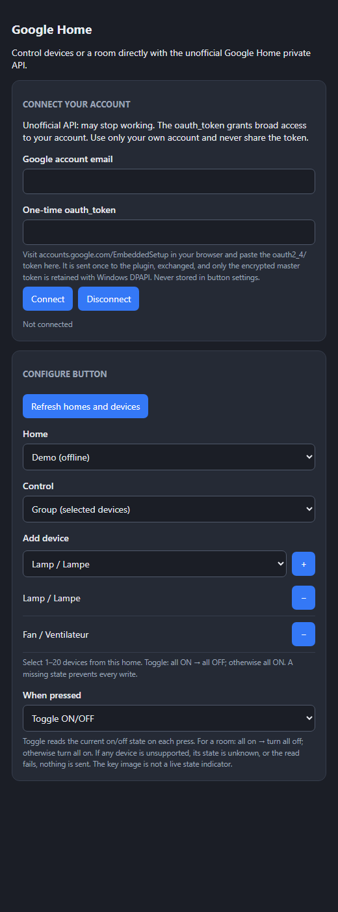
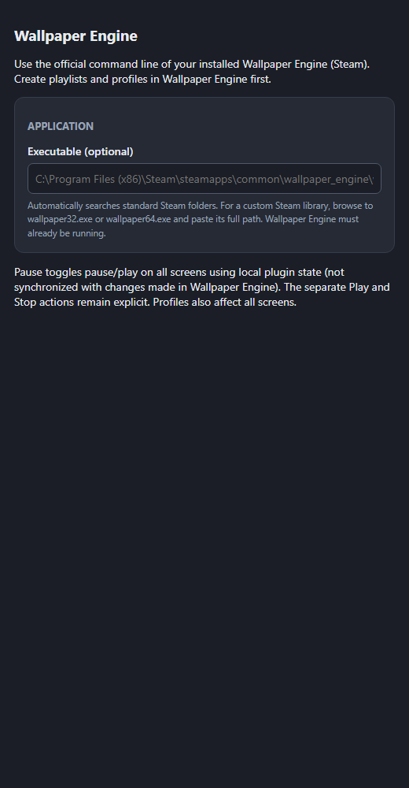
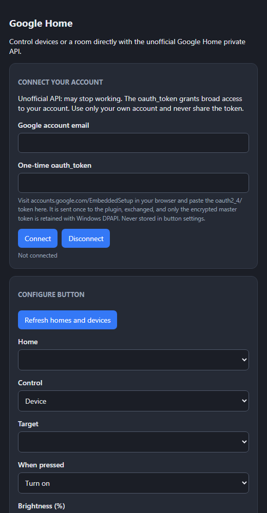
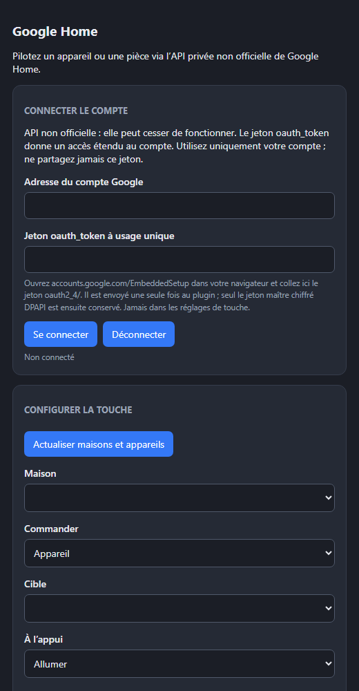
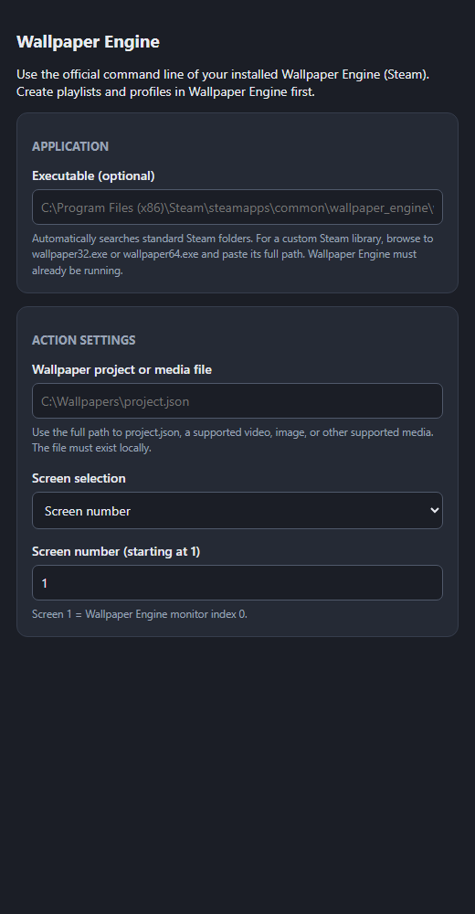
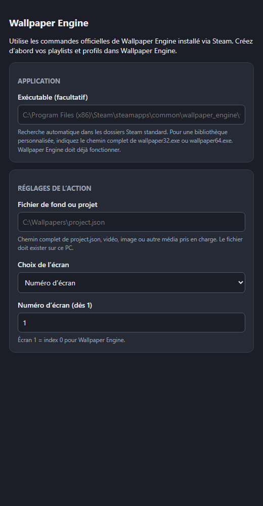
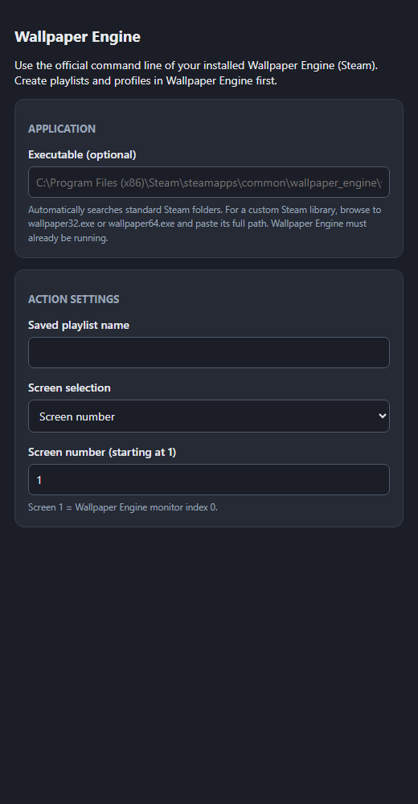
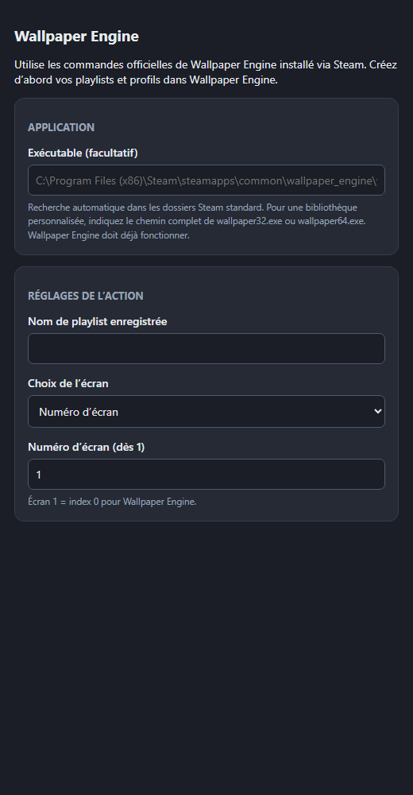

# First-party plugins / Plugins maison

## New in 1.0.4 / Nouveautés 1.0.4

**Google Home:** choose **Toggle ON/OFF** to read and invert the device's real state. Select **Group (selected devices)** and use **+** to add up to 20 devices from the same home, or **−** to remove one. For groups and rooms, all ON turns all OFF; otherwise all turn ON. Missing state or an unsupported target blocks the whole update before any write. Saved single-device settings and encrypted credentials are preserved.

**Google Home :** choisissez **Basculer ON/OFF** pour lire et inverser l'état réel. Sélectionnez **Groupe (appareils choisis)** puis **+** pour ajouter jusqu'à 20 appareils de la même maison, ou **−** pour en retirer un. Groupe/pièce : tous allumés → tous éteints ; sinon tous allumés. Un état inconnu ou un appareil incompatible bloque l'envoi avant toute écriture. Les réglages existants et la connexion chiffrée sont conservés.

**Wallpaper Engine:** the existing Pause action now alternates **Pause / Play** globally. Its state is local to the plugin, resets when it restarts and does not detect changes made outside the plugin. Explicit Play/Stop remain available. The official Next Wallpaper command and the installed 1.0.3 plugin were tested on a real Windows installation and changed only the selected display; this does not establish the cause of every NovyDeck key-trigger issue.

**Wallpaper Engine :** l'action Pause existante alterne désormais **Pause / Lecture** sur tous les écrans. Son état local repart à zéro au redémarrage du plugin et ne détecte pas les changements effectués ailleurs. Lecture et Arrêt explicites restent disponibles. La commande officielle et le plugin 1.0.3 installé ont changé le fond de l'écran ciblé lors d'essais réels ; le déclenchement depuis chaque touche NovyDeck reste à confirmer.

| New settings / Nouveaux réglages | English | Français |
| --- | --- | --- |
| Google Home group and toggle / groupe et bascule |  |  |
| Wallpaper Engine Pause / Play |  |  |

Inspector images use offline test devices, not live account data. / Les images des inspecteurs utilisent des appareils de test hors ligne, pas des données de compte réel.

## New in 1.0.3 / Nouveautés 1.0.3

Install from NovyDeck's plugin store, then return to the deck and find the installed plugin in **Action library → Plugins**. Drag its action onto a key to configure it. Google Assistant Command and Google Home are two separate plugins.

Installez depuis le magasin de plugins de NovyDeck, puis revenez au deck : retrouvez le plugin installé dans **Bibliothèque d'actions → Plugins**, et glissez son action sur une touche pour la régler. Commande Google Assistant et Google Home sont deux plugins distincts.

| Plugin | English inspector | Inspecteur français |
| --- | --- | --- |
| Google Home (experimental / expérimental) |  |  |
| Wallpaper Engine — wallpaper / fond |  |  |
| Wallpaper Engine — playlist |  |  |

These are real inspector captures initialized with local protocol fixtures, not proof of a Google account connection or a wallpaper change. / Captures réelles des inspecteurs initialisés avec des messages locaux de test, pas une preuve de connexion Google ou de changement de fond.

This workspace contains the SDK and nine Windows plugins: Clock, Counter, System Monitor, Now Playing, OLED Saver, Home Assistant, Google Assistant Command, Google Home and Wallpaper Engine. The SDK speaks the local Stream Deck WebSocket plugin protocol and renders 144×144 PNG keys with bundled DejaVu Sans (license in `novydeck-sdk/assets/DEJAVU-LICENSE.txt`). No Node runtime or CDN is required. Source and bundles are MIT licensed; the font retains its own license. Google Home and Wallpaper Engine use 1.0.4; the other seven manifests and the Rust workspace remain 1.0.3.

On Windows: `cargo generate-lockfile`, `cargo build --release --locked`, `cargo test --locked`, `cargo run --release --locked --bin render-previews`, `python tools/make_icons.py`, `python tools/capture_inspectors.py`, `python tools/package.py`. Icon generation needs Pillow; inspector previews use installed Microsoft Edge, offline with a fake local WebSocket. CI builds/tests on Windows and uploads plugin archives, `SHA256SUMS.txt` and previews for manual runs. Only `first-party-v*` tags publish releases; a branch run does not publish. Do not copy the registry template into `registry.json` until release URLs, SHA-256 and schema-validated metadata exist.

Home Assistant requires your own server and token. Google Assistant Command uses your own Google Cloud project, the Assistant API and desktop OAuth to send typed phrases; it does not directly select a device or room. Google Home instead controls devices or rooms through an unofficial private Google Home API: supply your own account email and a one-time `oauth2_4/` token from `accounts.google.com/EmbeddedSetup`. Google Home 1.0.4 adds a toggle mode alongside the saved on/off/brightness modes: each press reads `HomeControlService/GetTraits`, then reverses the selected device; for a room, all on turns all off, otherwise all turn on. It reads every selected device before sending one update; unsupported devices, missing/unknown state, or HTTP failures send no update. Two overlapping button presses are rejected while a command is running. Room selection uses stable home and room IDs, not names; button images are not live state indicators. Treat the token as account-wide access, never share it. Only an encrypted master token is retained under the Windows user's DPAPI; button settings must not contain tokens. The private API may change or stop working. Tests use anonymized offline shapes from piekstra/google-home-cli MIT commit `1370939af0bd3c1b85bd68701832833a8b7a045e` (`src/traits.rs`, `src/foyer.rs`), not live Google responses; no account or device was exercised.

Wallpaper Engine requires your own installed, running Steam version on Windows 10+. Choose `wallpaper32.exe` or `wallpaper64.exe` if not in standard Steam directories. Open a local project/media file or a previously saved playlist on one display (screen number starts at 1), go to the next wallpaper on a display, or apply a saved profile globally. Pause/play/stop/mute/unmute are global. Wallpaper Engine software and wallpaper content are proprietary and are NOT included or redistributed in these plugin archives; no real installation was exercised by CI.

En français : Google Home et Wallpaper Engine passent en 1.0.4 ; les sept autres plugins et le workspace restent en 1.0.3. « Commande Google Assistant » transmet une phrase via votre projet Cloud/OAuth ; « Google Home » pilote directement appareils ou pièces avec une API privée non officielle et stockage DPAPI. Sa nouvelle option « Basculer ON/OFF » lit l’état réel à chaque appui : appareil → état inverse ; pièce → si tous allumés, tout éteindre, sinon tout allumer. Si la lecture échoue, si un état manque ou si un appareil n’annonce pas OnOff, aucune commande n’est envoyée. Deux appuis simultanés ne sont pas exécutés en parallèle. Les images personnalisées ne reflètent pas l’état en direct. Ne partagez jamais le jeton : l’API peut changer et aucun compte réel n’a été testé. Wallpaper Engine exige votre propre installation Steam déjà lancée ; seuls les contrôles du plugin sont distribués, pas l'application ni les fonds. Les aperçus hors ligne et les tests CI ne constituent pas une validation sur compte, appareil ou service réel.
